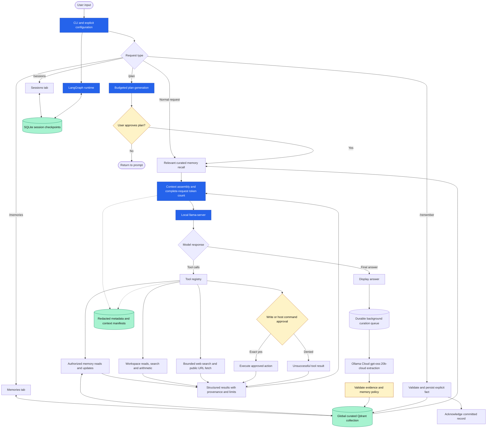
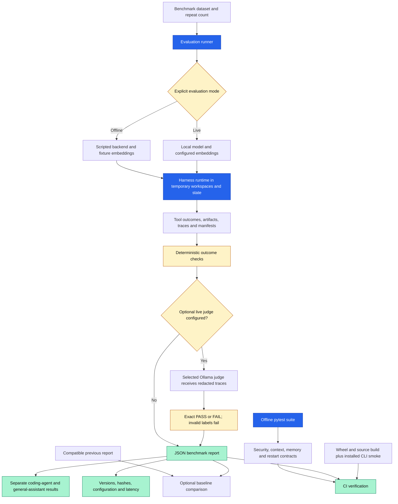

<p align="center">
  
</p>

<h1 align="center">Harness</h1>

A local coding and research CLI for Linux and WSL, built with LangGraph, llama.cpp,
Ollama embeddings, and Qdrant. Harness assembles bounded context before model calls,
persists resumable sessions, and requires explicit approval for writes and host commands.

**Approved shell commands run on your host, unsandboxed.** Workspace path checks apply
to file/search tools; they do not contain an approved shell command. Review every command.

## System architecture



*System architecture. Reads and web tools enforce their own limits; approved host
commands execute unsandboxed. Arrows show application data flow, not individual
LangGraph nodes.*

## Install and run

Requirements: Python 3.12+, Linux or WSL2, llama-server, Ollama, and a local GGUF model.
An executable `/usr/local/lib/ollama/llama-server` is supported as a CPU fallback.

If your llama-server needs CUDA libraries outside the system loader paths, set
`server_library_path: "/path/to/compatible/cuda/libraries"` in your selected config.
Harness prepends it to `LD_LIBRARY_PATH` for its server subprocess only. Match the
runtime major version to the binary; for example, a CUDA 12 build needs CUDA 12
libraries even when CUDA 13 is installed. Startup failures show the log's final 4 KiB.

```bash
git clone https://github.com/user-anto/Harness.git
cd Harness
make install
ollama pull mxbai-embed-large:latest
ollama pull gpt-oss:20b-cloud  # sign in to Ollama for cloud access
.venv/bin/harness-set-model /absolute/path/to/model.gguf
# Edit ~/.config/harness/config.yaml for your hardware.
.venv/bin/harness --workspace "$PWD" doctor
.venv/bin/harness --workspace "$PWD"
```

`make install` installs into this checkout's `.venv`; it does not add global shell
commands. Activate that environment before using plain command names:

```bash
source .venv/bin/activate
harness --help
harness-set-model /absolute/path/to/model.gguf
```

The activated commands work from other directories too. Alternatively, keep using
absolute paths to `.venv/bin/harness` and `.venv/bin/harness-set-model`.

`pip install .` or a built wheel installs a real `harness` console command. For use
with the exact tested development dependencies, use `pip install -c requirements.lock '.[dev]'`;
`make install` and CI use these constraints. For use
from any directory, explicitly select a config or copy the example to
`~/.config/harness/config.yaml`. Harness does not automatically load a repository's
config. For optional Ollama web search, an exported `OLLAMA_API_KEY` takes precedence;
otherwise Harness reads that key from the workspace `.env`. Other `.env` variables
are ignored, with no shell evaluation, variable interpolation or environment mutation.
Set `env_file: /absolute/path/to/.env` in your user config to reuse one credential
file across workspaces. Relative `env_file` paths resolve beside the selected config.

Run `harness-set-model /path/to/model.gguf` once to save your default model in
`~/.config/harness/config.yaml` (or `$XDG_CONFIG_HOME/harness/config.yaml`). Then
plain `harness` works from any directory while its installation is on `PATH`. Running the command again replaces the
model while preserving other config settings. The file must have a GGUF header;
the command does not load the model. Explicit `--config` files override this default.
With the repository virtual environment, use `.venv/bin/harness-set-model`.

```bash
harness --config ~/.config/harness/config.yaml --workspace ~/projects/example --session example
harness --config ~/.config/harness/config.yaml --workspace ~/projects/example --no-memory
harness --config ~/.config/harness/config.yaml doctor --probe  # requires an already running server
harness --config ~/.config/harness/config.yaml memory list
harness --config ~/.config/harness/config.yaml memory export > memories.json
harness --config ~/.config/harness/config.yaml memory forget MEMORY_ID
```

`--state-dir` or `HARNESS_STATE_DIR` changes runtime storage. The default is
`$XDG_STATE_HOME/harness` (normally `~/.local/state/harness`). Each launch starts a
fresh conversation with a generated session ID. To resume a saved conversation,
pass its ID with `--session ID`; startup explicitly reports the retained message
count. Session IDs are tied to their workspace. Global memories are separate and
can still be recalled in a fresh conversation. Older `default` history remains
available with `--session default`; `/clear` clears that session's active context.
Run `harness sessions` to list saved IDs, workspaces, update times and ready-to-copy
resume commands. Inside the interactive terminal, `/sessions` opens the Sessions tab.
You can choose a memorable ID from the start: `harness --session my-project`.
Display titles are separate from these stable IDs.

## Ollama API key

`OLLAMA_API_KEY` enables the `perform_web_search` tool. Add it using one of these
methods; an exported environment value takes precedence over a credential file.

### Workspace `.env`

Create or edit `.env` in the workspace you pass to `--workspace` (the current
directory by default), and add:

```dotenv
OLLAMA_API_KEY="your-ollama-api-key"
```

Keep existing entries when editing the file. Harness reads only `OLLAMA_API_KEY`;
it does not execute the file or load its other variables. Do not commit your key.

### Reuse the same key across workspaces

Put that same entry in a private file such as `~/.config/harness/.env`, then add
this setting to `~/.config/harness/config.yaml`, or to the config selected by
`--config`:

```yaml
env_file: "~/.config/harness/.env"
```

With `env_file` set, Harness reads that file instead of each workspace's `.env`.
Relative `env_file` paths resolve beside the selected YAML config.

### Export it in your shell

Alternatively, set the variable before launching Harness:

```bash
export OLLAMA_API_KEY="your-ollama-api-key"
harness
```

This applies to programs launched from that shell. An exported key overrides both
`env_file` and the workspace `.env`; `unset OLLAMA_API_KEY` returns to file lookup.

### Check the configuration

```bash
harness --workspace /path/to/project doctor
# For a separate configuration:
harness --config /path/to/config.yaml --workspace /path/to/project doctor
```

Look for `"web_search_key_available": true`. This checks that a nonempty key was
found without printing it; it does not verify that Ollama accepts the key. Doctor
also checks model/server prerequisites, so unrelated missing requirements can
produce a nonzero exit status. Restart a running Harness after changing credentials.
Ollama Cloud memory curation uses Ollama's own sign-in separately; this key setting
is for Harness web search.

## Interaction

Interactive terminals show the original animated, colored ASCII banner and progress
spinners, with a gray input box anchored at the bottom and streamed output above it.
Type `/` to open the command menu; ↑/↓ selects, Enter or Tab inserts, and Esc closes
the menu. Press Enter again to submit the chosen command. Shift+Enter inserts a newline;
Ctrl+J is a fallback. Terminals cannot distinguish left from right Shift. If your
terminal sends Shift+Enter as ordinary Enter, configure its key mapping as described
in [terminal setup](docs/terminal-setup.md).
Mouse-wheel or trackpad scrolling moves the conversation while preserving your input
draft; incoming output does not snap the view back to the bottom. Drag the mouse
over conversation text to select it, Ctrl+C copies, and Esc clears the selection.
Copying to the system clipboard uses the terminal's OSC 52 support; Ctrl+Y can paste
the internal clipboard into the composer. Shift+drag uses native terminal selection
on terminals that support bypassing application mouse handling.
Approval requests and their input are
cyan; only `yes` approves, while Enter, Esc and Ctrl+C deny. Answer text streams, and
model-provided reasoning appears separately in gray italics (`show_reasoning: false`
hides it). Reasoning is not stored in checkpoints or audit traces. Memory curation
runs independently in the background; the next input prompt does not wait for it.
Use `--plain` for the basic input prompt with
streaming, or `NO_COLOR=1` to keep the composer without colors. Redirected output has
no UI ANSI codes. On exit, the conversation is restored to normal terminal scrollback.

| Input | Behavior |
| --- | --- |
| A normal request | Recall relevant memories, assemble context, and run the tool loop |
| `/plan GOAL` | Show a structured proposed plan and require `yes` before execution |
| `/remember FACT` or `Please remember that FACT` | Save a confirmed fact, then acknowledge the committed record |
| `/memories [ID\|saved\|facts\|inferred\|notes]` | Open the Memories view; optionally select a record or filter its kind |
| `/sessions` | Browse saved session cards; search, load or delete a conversation |
| `/clear` | Clear this session's active context; long-term memory remains |
| `/help` | Show available commands |
| `/bye` | Close databases and terminate a model server started by this process |

Writes display their full path and content. Shell prompts display the exact command
and working directory. Only `yes` approves; Enter, EOF, `y`, and other responses deny.
Tool errors, denied operations, nonzero command exits, output floods, and timeouts
are represented as unsuccessful outcomes. Commands have a 30-second default timeout.

## Managing sessions

In the interactive terminal, `/sessions` opens full-width saved-session cards.
Use **↑/↓** to select, **Enter** to load and continue the selected conversation,
**Tab** to focus keyword search by session name, and **Esc** to return to the
current chat. **Backspace** while cards are focused asks for `yes` before deleting;
in the search box it edits the query. Deleting the current saved session creates a
fresh chat. Loading restores the conversation and its original workspace; missing
workspaces leave the current chat unchanged. Search and selection persist when
reopening the tab.

New sessions receive a short title from their first conversational prompt (or
`/plan` goal), without an additional model request. Titles stay fixed as the chat
continues; sessions saved before this feature display `UNKNOWN`. IDs remain the
stable identifiers for `--session`. Plain `harness sessions` still lists resume
commands. Deletion removes that session's checkpoints and title; global curated
memories remain separate.

## Managing memories

In the interactive terminal, `/memories` opens the Memories tab. Cards occupy the
left 70%; complete details appear in the right 30%. The search box filters by
keywords locally as you type. Up/Down selects a card; Tab switches between the cards
and search box. PgUp/PgDn or the mouse wheel scrolls the details pane.

With the cards focused, Backspace requests deletion. Only typing `yes` and pressing
Enter deletes the selected fact and all its versions. In the search box, Backspace
edits the query normally. Esc returns to agent chat, preserving the search and
selection for reopening. Background curation updates the visible list automatically.

Alt+M returns to chat with `Modify memory FULL_ID: ` already entered. Add your
instructions and send. The agent can inspect the record, reason and research, then
save its revised statement automatically. Its ID stays fixed and its embedding is
updated. The record keeps up to ten previous statements in `edit_history`, with
current evidence identifying the user edit request. Existing memory kind, fact key
and creation date are retained. A change during research rejects a stale update;
only the record selected by the current user request is writable. File and host-shell
operations retain their own approval requirements. Memory-edit requests skip
automatic extraction to avoid saving duplicate or stale facts from the editing exchange.

Plain mode and piped commands retain the readable memory listing. Use
`harness memory export` for full JSON and `harness memory forget ID` for deletion
outside the terminal browser. `/inspect` and `/forget` are no longer chat commands.

## Context and memory


*Context assembly and curated memory. Persistent checkpoints retain session state;
curated memory stores selected facts rather than a backup of every conversation.*

Main model generation and planning pass through the exact context budget. The
default input cap is 32,768 tokens, limited further by the
server's reported context capacity after reserving 4,096 output tokens and 10% headroom.
An owned server allocates only the context needed for that input and its reserves
(40,960 tokens by default), capped by `model_context`, to avoid unused KV-cache memory.
Counts include messages and tool definitions. Harness uses llama.cpp's complete-request
counting API, or its full-template/tokenizer endpoints on older builds; missing counting
support fails the request rather than guessing from character counts.

`gpu_layers: auto` lets llama.cpp fit GPU offloading to available VRAM; `0` explicitly
selects CPU execution. Owned servers use one slot for this single-user CLI. The
startup header shows the requested offload setting. Automatic memory curation uses
a separate Ollama model (`memory_model: gpt-oss:20b-cloud`) through the local Ollama
API, with `memory_keep_alive: 10m`. Eligible user excerpts and the final assistant
reply are sent to Ollama Cloud; raw tool calls, tool results and reasoning are excluded.
The request includes a JSON schema in the prompt and validates the response locally;
Ollama Cloud currently does not enforce structured output. Output is capped at 512
tokens with one retry at 1,024; cloud reasoning uses `think: low`. The adapter bounds UTF-8 input
bytes with additional template/output reserves because Ollama does not expose a
matching preflight tokenizer here; this is not an exact token count. Actual reported
usage is logged. Main model token counting remains exact. Partial JSON is never saved.
`memory_timeout: 120` bounds waiting; timed-out jobs retry once in the background.
Keep-alive is requested per call; the cloud provider controls residency, so it does
not guarantee constant loading time per session. A local model such as `llama3.2:3b`
can still be selected; only that path uses CPU-only `memory_threads: 2` and native
schema constraints. Direct facts send the newest eligible user turn and its final
assistant reply (up to 4,000 characters each, reduced further to fit the budget).
The reply helps interpret the exchange and can supply evidence for historical
answer notes; user facts still require user quotes. Other extraction requests
can add one related earlier excerpt (up to 500 characters) from the eight-turn local
evidence pool. Simple greetings and acknowledgements skip extraction.

The CLI queues curation after displaying the answer and immediately accepts the next
prompt. Pending jobs are private files, resume after restart, and expire with retention.
At most 32 jobs are kept; overflow skips the oldest queued automatic update with an
audit event and activity notice. Explicit `/remember` remains synchronous. Confirmed
memory deletion and `/clear` invalidate pending/in-flight curation so stale jobs cannot restore memory.
`memory_background: false` uses the synchronous main-model extraction path instead.
Programmatic runtimes can inject `MemoryCurator`; benchmarks use the synchronous path
to keep scripted calls deterministic. These settings do not change an already
running server: exit and restart the session to apply launch changes.

`/memories` shows green user-saved facts, cyan stated facts, amber tentative
insights and purple answer notes. Interactive cards show short IDs and update ages;
the details pane shows scores, evidence and source metadata. `/memories ID` selects
a record. `harness memory list` prints readable cards; `harness memory export`
produces JSON. Both export and the detail pane retain the complete stored payload.

System rules and the current tool-call group are preserved. Older complete turns may
be compacted into attributed excerpts; the pinned task record preserves the goal,
constraints, decisions, pending/completed work and evidence references. Excerpts are
lossy, so use a larger supported context or reread source ranges when needed. Tool
results carry provenance and truncation metadata. Fetched pages can be expanded with
`read_artifact`. Every call records a context manifest without raw reasoning.

Memory is enabled by default and uses **one global curated Qdrant collection**.
Records contain their own text and evidence; rotating audit logs does not destroy them.
The old `conversation_history` collection and checkout `qdrant_db` are not opened or migrated.

- Explicit facts persist immediately. Known credential/secret patterns are refused.
- Automatic user-stated facts require exact user-turn evidence and high extractor confidence.
- Inferred insights require evidence from two distinct user turns, remain tentative,
  and expire after 90 days unless reinforced. They can be wrong: inspect and forget them.
- User facts require user evidence. Substantive assistant conclusions can become
  dated `answer_note` records, including answers without source citations.
- Answer notes preserve what the assistant answered; they remain unverified and
  require revalidation before factual reuse, especially for changing information.
  Related URLs captured during successful web tools are attached locally, without
  sending raw tool messages to the extractor. A related URL does not verify the claim.
  Notes expire from recall after 30 days and use a separate key namespace.
- Raw tool calls, tool results and reasoning are excluded from automatic extraction.
- Each new prompt searches up to 20 candidates. Relevance, lexical overlap, recency,
  evidence type and workspace match select at most five records within 1,000 tokens.
  Cross-project records keep their source workspace label. Explicit facts outrank inferred ones.

The extractor's confidence is a model estimate, not proof. Stable fact keys resolve
known contradictions; semantic duplicates or conflicting keys can still need manual
cleanup. Known secret-pattern filtering is best effort, not a universal detector.
`--no-memory` disables retrieval, extraction and saving for the session. Forgetting
memory does not erase historical checkpoints in other sessions; session retention
defaults to 30 days. Local databases are private files, not encrypted storage.

See [the memory policy](docs/memory-policy.md) for the exact extraction flow,
confidence thresholds, evidence gates, correction precedence, and storage paths.

## Tests and evaluation



*Evaluation architecture. CI uses offline contracts; live model evaluations are
opt-in. Host shell tools are disabled in live benchmark runs. A cloud judge sends data
off the host. Scripted results are not model quality scores.*

```bash
make test       # tests/; offline, network connections blocked by the test fixture
make lint
make benchmark  # deterministic orchestration contracts, 3 repetitions per case
make build     # sdist and wheel
make eval      # opt-in local model evaluation; host shell tools disabled
```

The tests exercise paths and symlinks, approvals, timeouts, output limits, URL/DNS
restrictions, context overflow and tool-pair preservation, Qdrant persistence and
contradictions, inference evidence, redaction, checkpoint retention and restart recovery.

Benchmark JSON reports separate coding-agent and general-assistant results, including
failures, traces, context manifests, versions, dataset hash, configuration and latency.
`--repeats`, `--output`, and `--baseline PREVIOUS.json` support repeatable comparisons.
Offline scripts test system contracts; they do not measure model intelligence or
prompt-injection resistance. Live scores are separate and can fail even when all
offline tests pass. No previous v2 judge-only score is treated as a v3 baseline.

```bash
.venv/bin/python evals/run_evals.py --live --config config.yaml --repeats 3
# Optional: this sends redacted traces to the selected Ollama judge; cloud models leave the host.
.venv/bin/python evals/run_evals.py --live --config config.yaml --judge MODEL_NAME
```

The active dataset is `evals/benchmarks.json`; see the [evaluation guide](evals/README.md)
for custom datasets and report fields. Obsolete v2 datasets, CSV scores and the radar
plotter have been removed. They are recoverable from Git history and are not v3 baselines.

## Project structure

```text
harness/                 Installable application package
  cli.py, commands.py    Entry point and slash-command registry
  tui.py, ui.py          Interactive terminal and plain streaming output
  browser.py            Shared card navigation control
  memory_browser.py     Memories tab
  session_browser.py    Sessions tab
  sessions.py           Saved-session listing and display titles
  runtime.py            LangGraph loop, checkpoints and session operations
  context.py, prompts.py Context assembly and model instructions
  memory.py, curation.py Curated storage and background extraction
  backend.py            llama.cpp transport and server lifecycle
  tools.py, web.py      Workspace, memory and web tools
  config.py, credentials.py, security.py, audit.py, set_model.py
  banner.ansi           Packaged terminal artwork
tests/                  Offline system and terminal interaction tests
evals/                  Current dataset, runner and evaluation guide
docs/                   Architecture, policies, terminal setup and development
.github/workflows/ci.yml Automated verification on pushes and pull requests
config.yaml             Explicit example configuration
pyproject.toml          Dependencies, package data and console commands
requirements.lock      Tested dependency constraints
Makefile, MANIFEST.in   Development tasks and source-distribution contents
```

The application has one package, `harness`. Use `harness` or `python -m harness`;
obsolete `src.*` import shims and `python -m src.graph` have been removed.
Runtime data lives under the configured state directory, separately from source.
Generated `.venv/`, `dist/`, caches and `evals/reports/` are ignored by Git.

See the [development and CI guide](docs/development.md) for module responsibilities,
cleanup decisions, and what each CI step checks. GitHub runs the workflow
on both Python 3.12 and 3.13; it checks lint, offline tests and benchmarks, builds
packages, and verifies the installed wheel outside the checkout. It is not required
to launch Harness, but helps catch broken changes and packaging omissions before merge.

## Architecture and limits

Imports do not start servers or databases. Runtime storage uses restrictive permissions,
with configurable retention for idle sessions, artifacts, and audit files. Logs are
ordinary writable JSONL, not immutable or tamper-proof audit records. Only one active
runtime may use a state directory. This release targets a local single-user CLI;
multi-user deployments need different storage, authentication and process isolation.

See [prompt structure](docs/prompt-structure.md), [threat model](docs/threat-model.md), [architecture decisions](docs/architecture.md),
[terminal setup](docs/terminal-setup.md), [memory policy](docs/memory-policy.md),
[development and CI](docs/development.md), [evaluation guide](evals/README.md),
[WSL smoke test](docs/wsl-smoke-test.md), and [test guide](tests/README.md).

## License

[MIT](LICENSE).
