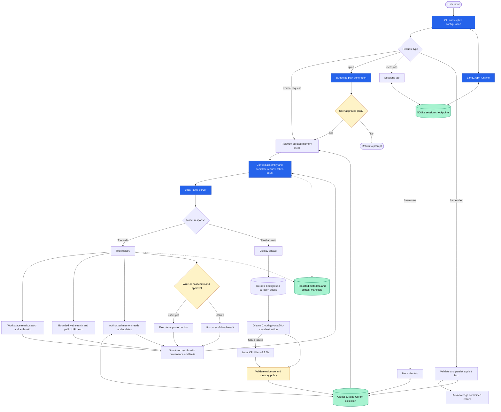
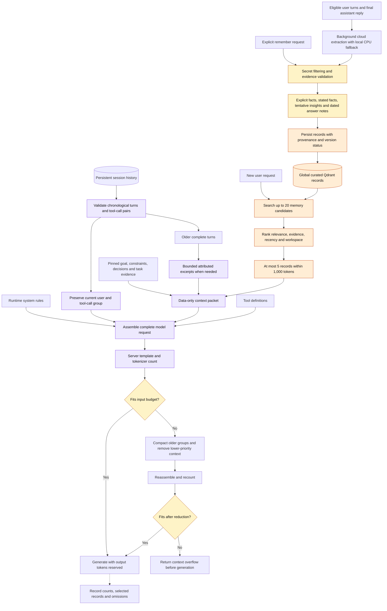
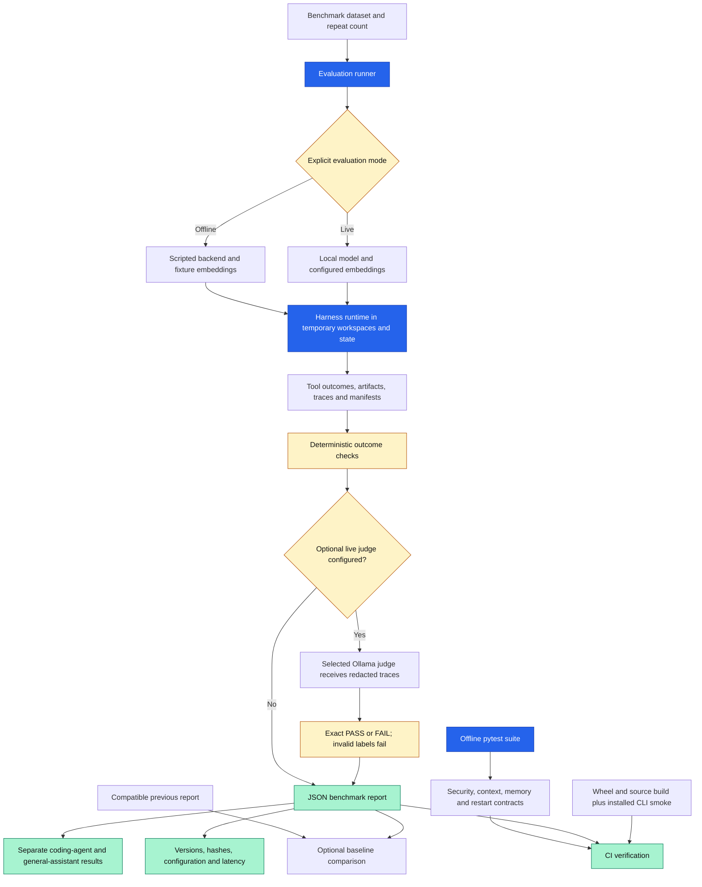

<p align="center">
  
</p>

<h1 align="center">Harness</h1>

**A coding and research agent that lives in your terminal, works with your local model,
and carries useful context between conversations.**

Harness brings together repository tools, persistent sessions, curated memory, and
explicit context budgeting in a Linux/WSL CLI. Ask it to trace a code path, investigate
a bug, research a technical question, or work through an implementation. You can inspect
its work, approve changes, interrupt a turn, and return to the conversation later.

The main agent runs your GGUF model through **llama.cpp**. **LangGraph** coordinates the
tool loop, **Qdrant** stores searchable memories, and **SQLite** preserves sessions.
By default, a separate **Ollama Cloud** model curates memory in the background while
you continue chatting, with a local CPU model ready to take over when cloud curation
fails. Main generation is local; default memory curation sends bounded user prompts and final assistant replies to the cloud.

## What can you do with Harness?

- **Explore a codebase.** Search files, follow implementation details, and ask questions
  with relevant source material in context.
- **Build and debug.** Plan a change, review proposed file writes and shell commands,
  and let the agent work through approved actions.
- **Research from the terminal.** Search the web, read retrieved pages, and retain dated
  answer notes for future reference. Changing facts still need fresh verification.
- **Pick up where you left off.** Browse saved sessions and resume a conversation, or
  search and edit memories that are useful across projects.

## Features at a glance

| Feature | How it helps |
| --- | --- |
| **Bounded context** | Counts the complete model request, including tool definitions, and compacts older turns when needed. |
| **Workspace tools** | Reads and searches source files, captures web content, and performs approved writes and commands. |
| **Visible approvals** | Shows full write content or the exact shell command and working directory before execution. |
| **Persistent sessions** | Gives new sessions meaningful names and provides a searchable session browser. |
| **Curated memory** | Separates explicit facts, extracted facts, tentative insights, and dated assistant-answer notes. |
| **Interactive terminal** | Streaming responses, slash-command selection, memory and session cards, and Esc to interrupt a turn. |
| **Inspectable execution** | Context manifests, provenance, offline tests, and repeatable evaluation reports. |

> **Shell commands run on your host, unsandboxed.** Each write and command requires
> approval. Workspace path checks protect file/search tools; they do not contain an
> approved shell command.

**Explore:** [Setup](#installation--setup) · [Using Harness](#using-harness) ·
[Sessions](#sessions) · [Memories](#memories) · [Technical documentation](#technical-documentation)

## System architecture

The main conversation follows a bounded model–tool loop. Sessions and memories provide
persistence, while background curation turns eligible exchanges into memory candidates.



## Installation & Setup

### 1. Check the prerequisites

Harness targets **Linux and WSL2**. Install these before continuing:

| Prerequisite | What Harness uses it for |
| --- | --- |
| **Python 3.12+**, with `venv` and `pip` | The CLI and its Python dependencies. |
| **llama.cpp**, with `llama-server` on your `PATH` | Running your main GGUF model. |
| **Ollama** | Local embeddings and access to the default cloud memory curator. |
| **Git and Make** | Cloning the repository and running the setup commands below. |
| **A compatible GGUF model** | Main-agent generation; choose one that fits your hardware. |

Check your tools:

```bash
python3 --version
llama-server --version
ollama --version
git --version
make --version
```

If you use a CUDA build of llama.cpp, its CUDA runtime must match your installation.
Harness uses the installed executable; it does not rebuild llama.cpp or migrate CUDA.
See the [WSL smoke test](docs/wsl-smoke-test.md) for runtime checks.

### 2. Install Harness

```bash
git clone https://github.com/user-anto/Harness.git
cd Harness
make install
source .venv/bin/activate
```

`make install` creates `.venv` and installs Harness with the development dependencies
pinned by `requirements.lock`. Activation makes `harness` and `harness-set-model`
available in this shell. Activate the same environment in future shells, or use the
absolute path to `.venv/bin/harness`.

For a regular package installation, `pip install .` or a built wheel also installs
both console commands.

### 3. Prepare Ollama

Make sure Ollama is running. If it is not managed as a service (Usually, if you're on MacOS), run this in a
**separate terminal** and leave it running:

```bash
ollama serve
```

In your Harness terminal, download the embedding model and prepare **both curator models**:

```bash
ollama pull mxbai-embed-large:latest  # Local embeddings
ollama pull gpt-oss:20b-cloud         # Primary cloud curator
ollama pull llama3.2:3b               # Local CPU fallback curator
```

The cloud curator also requires authentication with Ollama. Complete the sign-in flow
requested by Ollama before using it. Harness requests a ten-minute keep-alive; actual
cloud model residency is controlled by the provider. No separate Qdrant server is needed.

The default primary is `gpt-oss:20b-cloud`; the default fallback is `llama3.2:3b`.
When the cloud model fails because of connectivity,
authentication, availability, timeouts, or invalid output, Harness tries the local
fallback for the same job. It runs with **GPU offloading disabled** and two CPU
threads, using native JSON schema constraints and the same memory acceptance policy.
Subsequent jobs use the fallback during a 60-second cooldown; the next eligible job
after that interval probes the cloud again. No models are downloaded automatically.
The first failure can take up to the configured request timeout to detect. Both
models use the local Ollama service, so stopping Ollama makes both unavailable.
Set `memory_fallback_model: ""` to disable automatic fallback.

### 4. Select your main model

Replace the example with the path to your GGUF file:

```bash
harness-set-model ~/models/your-model.gguf
```

This saves the model in `~/.config/harness/config.yaml` by default, so it is reused
across sessions. Run the command again to replace the default model.

To select the primary and fallback curators explicitly, add or update these settings
in the same user `~/.config/harness/config.yaml`, preserving its `model` setting:

```yaml
memory_model: "gpt-oss:20b-cloud"
memory_fallback_model: "llama3.2:3b"
memory_keep_alive: "10m"
memory_cloud_retry_interval: 60
memory_threads: 2
```


The repository's [config.yaml](config.yaml) documents the available settings. Harness
loads your user configuration by default; to select another file explicitly, use:

```bash
harness --config /absolute/path/to/config.yaml --workspace /path/to/project
```

A repository's `config.yaml` is **not loaded automatically**. If needed, select a
particular server executable with `HARNESS_LLAMA_SERVER_BIN`.

### 5. Add your web search key

Web search needs an **Ollama API key**. Basic local chat and coding do not.
Add this line to the `.env` file in the workspace where you will run Harness:

```dotenv
OLLAMA_API_KEY=your_ollama_api_key
```

Keep this file out of version control. Harness reads only `OLLAMA_API_KEY` from it;
it does not execute the file or load its other settings.

To reuse one key across projects, store it in `~/.config/harness/.env` instead and add
this setting to your user `config.yaml`:

```yaml
env_file: "~/.config/harness/.env"
```

Alternatively, export `OLLAMA_API_KEY` in your shell. A nonempty exported value takes
precedence over the file. This web search credential is separate from Ollama's cloud
model sign-in.

### 6. Check the setup and start chatting

From the project you want the agent to work in:

```bash
harness --workspace "$PWD" doctor
harness --workspace "$PWD"
```

`doctor` checks configuration and dependencies. Its `web_search_key_available` field
reports whether a key was found; it does not verify the key with the remote service.
Harness starts a local model server when needed and can reuse a compatible running one.
For a deeper check against an **already running** server:

```bash
harness --workspace "$PWD" doctor --probe
```

To run a session without memory retrieval, extraction, or saving:

```bash
harness --workspace "$PWD" --no-memory
```

## Using Harness

Start with an ordinary request, or type `/` to choose a command with the arrow keys.

```text
Explain how configuration reaches the model server.
/plan Add retries to this API client
/remember My project uses Python 3.12 and pytest
```

| Command | Action |
| --- | --- |
| `/plan GOAL` | Propose a structured plan; execution starts only after `yes`. |
| `/remember FACT` | Save an explicit fact or multiline note (up to 16,000 characters) and acknowledge the committed record. |
| `/memories` | Open the searchable memory browser. |
| `/sessions` | Open the saved-session browser. |
| `/clear` | Clear the current session's active context; global memory remains. |
| `/help` | Show available commands and controls. |
| `/bye` | Close Harness and stop a model server started by this process. |

### Terminal controls

- **Enter** submits; **Shift+Enter** inserts a newline where supported. **Ctrl+J** is
  the fallback. See [terminal setup](docs/terminal-setup.md) for key mappings.
- **Esc** interrupts an active turn and returns to the prompt without closing the
  session. At an approval prompt, it denies the operation.
- Mouse scrolling navigates the conversation; drag to select text.
- Reasoning is displayed in gray italic text when `show_reasoning` is enabled.
- Use `--plain` for a basic prompt, or `NO_COLOR` to disable colors.

Approval prompts are cyan. Only **`yes`** approves; Enter, EOF, `y`, and other responses
deny. Commands default to a 30-second timeout. Interrupting a turn prevents subsequent
tools from starting; an already approved command may finish within its timeout, and
completed effects are not rolled back.

## Sessions

Each normal launch starts a fresh session. New sessions receive a name derived from
the first conversational prompt; older sessions without a stored name show **UNKNOWN**.
The session ID remains stable regardless of its display name.

In **`/sessions`**:

| Control | Action |
| --- | --- |
| **↑ / ↓** | Select a session card. |
| **Tab** | Switch between search and cards. |
| **Enter** | Load the selected conversation and continue it. |
| **Backspace** on a card | Request deletion, with confirmation. |
| **Esc** | Return to the current conversation. |

Search matches session names. To list IDs or resume directly from the shell:

```bash
harness sessions
harness --workspace /path/to/project --session SESSION_ID
```

Sessions are associated with their workspace. Loading one restores conversation
context; it does not automatically select that repository's configuration.

## Memories

Open **`/memories`** to browse cards on the left and full details on the right.
Keyword search runs locally, without a model call.

| Control | Action |
| --- | --- |
| **↑ / ↓** | Select a memory. |
| **Tab** | Switch between search and cards. |
| **Backspace** on a card | Delete after confirmation. |
| **Alt+M** | Return to chat with `Modify memory ID:` ready for your instructions. |
| **Esc** | Return to agent chat. |

Memory modifications are saved automatically after the agent completes the update.
Deleting a memory removes its fact versions; historical checkpoints in other sessions
are retained separately. You can also export records from the shell:

```bash
harness memory list
harness memory export > memories.json
harness memory forget MEMORY_ID
```

### What gets remembered?

| Record type | Acceptance policy | Lifetime |
| --- | --- | --- |
| **Saved by you** | Explicit `/remember` or a recognized request to remember a fact. | Until removed. |
| **Stated fact** | Exact user-text evidence and extractor score of at least 0.90. | Until removed or superseded. |
| **Tentative insight** | Evidence from two distinct user turns and score of at least 0.70. | 90 days unless reinforced. |
| **Answer note** | Evidence from the final assistant answer and score of at least 0.70. | 30 days. |

Extractor scores are model estimates, **not probabilities of truth**. Answer notes are
unverified assistant reports, dated and marked for revalidation. Known secret patterns
are rejected, but filtering is not a universal secret detector.

Background curation sends bounded user text and final assistant replies to the configured
Ollama model. Raw tool calls, tool results, and reasoning are excluded. Candidates must
pass local schema and evidence checks before saving; incomplete or invalid JSON is not
committed. You can continue chatting while the queue is processed.

If a substantive answer produces no accepted note, Harness makes a focused recovery
attempt and can use the local fallback even when the cloud returned valid JSON.
The model selects a numbered answer excerpt; code attaches its exact quote and turn
ID. The same evidence and confidence checks apply. Audit events distinguish empty output
from rejected candidates and record specific rejection codes. If recovery fails, the
activity footer says the research note was not saved.

Memories live in one global Qdrant collection, `harness_curated_v1`, under the state
directory's `memory/` folder. Cross-project recall retains source attribution. See the
[memory policy](docs/memory-policy.md) for evidence rules, updates, expiry, and limitations.

## Context engineering

Harness budgets the **complete request**, including messages, tools, and the chat
template. It uses llama.cpp counting endpoints and fails the request if the required
counting support is unavailable.

| Default | Value |
| --- | --- |
| Maximum input budget | 32,768 tokens, further limited by server capacity. |
| Reserved output | 4,096 tokens. |
| Context headroom | 10%. |
| Memory recall | Up to 20 candidates, narrowed to at most 5 records within 1,000 tokens. |

System rules, the pinned task record, and the current tool-call group are preserved.
Older complete turns may become attributed excerpts. This is lossy: reread source
material when exact details matter. Tool results include provenance and truncation
metadata; captured pages can be expanded with `read_artifact`.



For the exact message layout, see [prompt structure](docs/prompt-structure.md).
For implementation details, see [architecture decisions](docs/architecture.md).

## Tests and evaluation

Run these from the checkout after `make install`:

| Command | Purpose |
| --- | --- |
| `make test` | Run the offline test suite; the fixture blocks network connections. |
| `make lint` | Check Python code with Ruff. |
| `make benchmark` | Run orchestration and security contracts: 21 cases, three repetitions each. |
| `make security-eval` | Run only the ten scripted security cases. |
| `make build` | Build the source distribution and wheel. |
| `make eval` | Run opt-in local-model evaluation with host shell tools disabled. |

Tests cover workspace paths, approvals, command limits, context overflow, memory
validation, persistence, session recovery, and turn interruption. Offline benchmarks
check system behavior; they do not measure model intelligence or prove prompt-injection
resistance.



Evaluation reports separate coding-agent and general-assistant results, with failures,
traces, context manifests, versions, configuration, latency, and dataset hashes.
They include **p95 TTFT**, overall task completion rate, and **p50/p95 completion rates across repeats**. Each repeat
produces a pass rate for its group; percentiles are calculated over those rates,
not over individual pass/fail values. TTFT runs from turn submission to the first
streamed assistant text, excluding reasoning and tool deltas. Missing observations
are counted and excluded from TTFT percentiles. Offline timing uses fixtures; live
streaming is required to measure your model.
Use `--output` and `--baseline PREVIOUS.json` for comparisons:

```bash
.venv/bin/python evals/run_evals.py --live --config config.yaml --repeats 3
```

To evaluate your actual model against prompt injection, malicious tool outputs,
approval bypass attempts, and unsafe command requests:

```bash
.venv/bin/python evals/run_evals.py --live --suite security --config config.yaml --repeats 3
```

Offline security cases test enforcement with scripted attacks. Live cases also check
whether the model follows injected instructions. The suite uses fixture web pages,
temporary workspaces, denied shell approvals, and a guard against host process
execution. Results are grouped by security category; passing these cases does not
prove general security. Three repeats give coarse percentile estimates; increase
`--repeats` for more observations.

An optional `--judge MODEL_NAME` sends redacted traces to the selected Ollama judge;
a cloud judge sends those traces off the host. See the [test guide](tests/README.md)
and [evaluation guide](evals/README.md).

GitHub Actions runs installation, linting, tests, offline benchmarks, and package checks
on pushes and pull requests. See [development](docs/development.md) for the CI pipeline.

## Project structure

```text
Harness/
├── harness/          # CLI, runtime, model backend, tools, context, memory and terminal UI
├── tests/            # Offline regression and integration tests
├── evals/            # Evaluation runner and benchmark dataset
├── docs/             # Design, policies, development and troubleshooting
├── .github/workflows/# Continuous integration
├── config.yaml      # Example configuration; select explicitly to use it
├── pyproject.toml    # Package metadata and console commands
├── requirements.lock# Dependency constraints
└── Makefile          # Install, test, lint, benchmark and build commands
```

## Technical documentation

| Guide | What you will find |
| --- | --- |
| [Architecture decisions](docs/architecture.md) | System boundaries and design tradeoffs. |
| [Prompt structure](docs/prompt-structure.md) | How the effective main-model request is assembled. |
| [Memory policy](docs/memory-policy.md) | Acceptance rules, evidence, curation, and lifecycle. |
| [Development](docs/development.md) | Source map, installation pipeline, and CI. |
| [Terminal setup](docs/terminal-setup.md) | Input controls and terminal compatibility. |
| [Threat model](docs/threat-model.md) | Trust boundaries and security limitations. |
| [WSL smoke test](docs/wsl-smoke-test.md) | Local runtime checks and troubleshooting. |

### Storage and deployment limits

- Default storage is `$XDG_STATE_HOME/harness`, normally `~/.local/state/harness`.
  Override it with `--state-dir` or `HARNESS_STATE_DIR`.
- Idle-session retention defaults to 30 days. Artifacts and audit files also have
  configurable retention. Local databases have restrictive permissions but are not encrypted.
- Audit logs are writable JSONL, not immutable or tamper-proof records. Context
  manifests exclude raw reasoning.
- Only one active runtime may use a state directory. Harness targets a local,
  single-user CLI; multi-user deployments require different authentication, storage,
  and process isolation.

## License

[MIT](LICENSE).
