# Memory extraction and acceptance policy

## Who sends what

After a normal answer, the CLI queues a background extraction job. `MemoryCurator`
sends that request to the separate Ollama model configured by `memory_model`
(default `gpt-oss:20b-cloud`), through the local Ollama API. The cloud model executes
on Ollama's servers; eligible user text and final assistant replies leave the host.
No `ollama run` subprocess is needed: Harness calls the local API directly. Main
GPU generation and user input continue independently. The request contains a separate
extraction instruction, the newest eligible user turn with its ID, and an
`assistant_reply` field containing only its final answer. Raw tool messages, calls
and reasoning are excluded. Known-secret and quoted-code user turns are excluded;
the user excerpt and redacted assistant reply are capped at 4,000 characters each.
Only user excerpts can establish facts about the user. A separate `answer_note`
kind can quote the final assistant reply to retain a historical research answer or
reusable explanation, even without source citations. Assistant guesses cannot
establish user facts.

The runtime retains up to eight eligible turns locally as an evidence pool. Direct
facts use only the newest turn. Other requests may include one earlier excerpt of
at most 500 characters when at least two meaningful words overlap, allowing
two-turn inference without repeatedly sending the entire pool. This lexical
heuristic can miss related evidence or select a weak match; deterministic evidence
checks still apply. Simple greetings and acknowledgements skip the model entirely.
Older curated records remain in Qdrant after their source turns leave this pool.

```mermaid
flowchart LR
  User[Recent user turns] --> Runtime[Harness runtime]
  Runtime --> Queue[Durable background queue]
  Queue -->|User excerpts and final reply| Model[Ollama Cloud gpt-oss:20b-cloud]
  Model -->|Unavailable or invalid output| Fallback[Local llama3.2:3b on CPU]
  Fallback -->|Candidate JSON and self-rated scores| Validate
  Model -->|Candidate JSON and self-rated scores| Validate[Deterministic evidence and policy checks]
  Validate -->|Accepted statements| Embed[Local Ollama embedding model]
  Embed --> Qdrant[Local curated Qdrant collection]
```



## Reasoning

Normal chat and tool-loop requests keep the model's normal reasoning behavior.
Reasoning provided by the main model is displayed separately in gray italic text
when `show_reasoning` is true. It is not stored as answer content or in audit traces.
The cloud extractor is a separate structured-data task with `think: low`; its
reasoning is discarded, rather than stored in the conversation or memory.
The optional synchronous extraction fallback alone explicitly disables reasoning
on the main model for its extraction request.

The cloud request describes a JSON schema in the prompt, starts with a 512-token
limit, and can retry once with up to 1,024 tokens. Ollama Cloud does not currently
support schema-enforced structured output, so local checks validate field names,
types, lengths, evidence, and confidence before saving. A local model can still use
native schema constraints. The worker uses an 8,192-token context budget.
Because this Ollama adapter has no preflight tokenizer, it
conservatively limits UTF-8 input bytes, reserves template/output space, drops older
whole turns, shortens the assistant reply, then shortens the newest user excerpt
if necessary, and logs actual server
usage. That bound is not presented as an exact token count. The main model's exact
token counting is unchanged. Cut-off or malformed JSON is never repaired into facts or
partially saved. If cloud attempts fail, the configured local fallback processes the
same exchange; neither model's partial output is committed. If fallback also fails,
the answer remains available and the activity footer reports the curation failure.

`memory_timeout` defaults to 120 seconds for the HTTP read timeout and streamed
generation deadline. A timed-out job is retried once in the background, then reported
as unavailable; this does not block the next prompt. `memory_keep_alive: 10m` is sent
on every call. Cloud residency is provider controlled; this does not promise fixed
loading latency. Local CPU models still use `memory_threads` and `num_gpu: 0`.

### Automatic local fallback

`memory_fallback_model` defaults to `llama3.2:3b`. Pull it beforehand with
`ollama pull llama3.2:3b`; Harness never downloads it automatically. When a cloud
extractor fails registration, transport, authentication, generation, or JSON validation,
the adapter tries this local model for the same exchange. An empty candidate list alone is a valid response, not an availability failure.
A missing expected research note instead enters the focused recovery path below. Model failures do not change acceptance
thresholds, evidence matching, secret filtering, or the main agent model.

Local requests use native schema constraints, `num_gpu: 0`, the configured
`memory_threads` (default 2), and the same context/keep-alive settings. Remote-model
metadata is rejected for the fallback, even if the configured alias looks local.
`memory_fallback_model: ""` disables the feature. A deliberately local primary
curator does not invoke the cloud-to-local fallback path.

After cloud failure, subsequent jobs use local fallback until
`memory_cloud_retry_interval` seconds have elapsed (default 60). The next eligible
job then retries the primary; a successful primary response restores normal cloud
use. This cooldown is process-local, not a scheduled health probe. Detecting the
initial failure still depends on the configured HTTP timeout/deadline. Each model
has its own generation deadline, so a job that switches models can take longer
than one `memory_timeout` interval. The local
Ollama service is shared by both models, so a stopped service prevents both paths.

`memory_fallback` audit events record model identities and the exception category,
without copying failed output. Context/generation events identify the model used;
accepted background writes record the actual successful extractor model. Stale or
cancelled jobs do not begin fallback or save its results. If both models fail,
no new candidates from that job are saved. Underlying memory/embedding failures
are separate from extractor fallback.

Pending jobs are atomically saved in `<state_dir>/curation-pending.json` with mode
0600 and resumed on restart. Jobs expire according to session retention. The queue
holds at most 32 jobs; overflow skips the oldest queued automatic update with an
audit event and activity notice. `/remember` saves immediately instead of entering
this queue. Forgetting memory or clearing context invalidates older jobs, including
an in-flight result; a stale worker cannot commit those memories later. Graceful
exit stops further commits and leaves unfinished valid jobs for the next launch.

## Missing answer notes and rejection diagnostics

A parsed JSON response is not proof that a memory was saved. Every background batch
now records `memory_selection` with candidate, accepted and rejected counts, including
an explicit `empty_candidates` or `all_rejected` outcome. Rejected candidates produce
`memory_candidate_rejected` events with fixed field paths and reason codes such as
`below_threshold`, `assistant_quote_or_turn_mismatch`, `assistant_personal_guess`, or
`two_distinct_turns_required`. Schema failures also include field-level errors and the
opaque source turn ID. These events exclude raw statements, quotes and unknown keys.

If no accepted answer note accompanies a substantive final answer, the worker performs
one focused recovery pass per job attempt. This conservative trigger requires at
least 200 characters and 35 words of answer content, and excludes known sensitive
content, personal guesses, short acknowledgements, refusals/tool failures and memory
status messages. It is a retry heuristic, not a decision to save or verify a claim.
Short useful notes can still be accepted by the normal extractor.

The recovery prompt asks for one concise historical note and a numbered excerpt
selection, preserving uncertainty. Up to six exact source slices (200 characters
each) are supplied, with uncertainty/candidate passages prioritized. The model emits
only a statement, confidence, and `evidence_id`. Code binds the exact quote, latest
turn ID, `answer_note` kind, and a stable exchange key. Unknown excerpt IDs are
rejected; quotes and opaque UUIDs no longer need to be copied by the model. The
statement must still pass the normal policy checks. Source matching alone does not
prove entailment or factual truth.

The focused prompt omits unrelated user-profile instructions to leave room for the
answer. Each model gets one 1,024-token recovery attempt. An empty or policy-rejected cloud recovery counts as a failure and can use
the configured local fallback, even when the initial cloud response was valid JSON.
The same confidence, evidence, secret and personal-claim checks apply throughout.
Accepted user facts from the initial pass remain saved and are not resubmitted as
part of note recovery. Dates and locally captured source references are retained.

`memory_note_retry` records why recovery started. Recovery still runs in the background
and obeys invalidation/shutdown checks. If no note passes after the bounded attempts,
the activity footer reports that the research answer note was not saved; successful
JSON alone no longer hides that outcome. Existing timeout retry limits still apply.
The synchronous path also records rejection diagnostics and can use its remaining
second extraction attempt with the same numbered-source recovery format; it does not call the Ollama fallback.

## Explicit note length

`/remember` stores the full supplied text without an LLM summarization step. Explicit
notes and edits to them accept up to 16,000 characters; automatically generated
statements retain their 1,000-character limit. Over-limit errors report the limit
and supplied length. Secret filtering still checks the entire statement and evidence.
Large notes remain subject to the normal recall/context budget; the full record is
available in the Memories details view and through `read_memory`.

## Confidence and acceptance

Confidence is a number proposed by the extractor model. It is not measured factual
accuracy or a calibrated probability. The thresholds are policy choices, not a
claim that a score of 0.90 means a 90% chance of truth.

| Kind | Requirements | Stored confidence | Expiry |
| --- | --- | --- | --- |
| Explicit `/remember` request | Nonempty fact, user-provided evidence, no known secret pattern | 1.0 means explicitly supplied, not independently verified | No automatic expiry |
| Automatic user-stated fact | Score at least 0.90, exact user quote, newest turn cited | Model's proposed score | No automatic expiry |
| Automatic inferred insight | Score at least 0.70, exact quotes from at least two distinct turns, newest turn cited | Capped at 0.85; treated as tentative | 90 days after save or reinforcement |
| Historical answer note | Score at least 0.70, exact newest assistant-reply quote; at most one per exchange | Capped at 0.85; selection score, not truth | 30 days from the recorded exchange |

## Dated answer notes

Research results and substantive technical explanations are retained independently
of user-profile facts. A question can yield an answer note even when the user states
no durable fact. Empty acknowledgements, typo clarifications, failed attempts and
task-status messages are excluded by extraction instructions. Known patterns of
assistant claims about the user's attributes are also refused for notes; this is
a conservative heuristic and may reject useful wording or miss unfamiliar phrasing.

The payload records `verification: assistant_reported`, `requires_revalidation: true`,
the exchange date (`observed_at`), user question, and exact assistant quote. Queued
jobs preserve the original exchange date rather than assigning the restart date.
Keys use the `answer_note.` namespace, so notes cannot supersede profile facts.
They have the lowest recall priority and expire from recall after 30 days; expiry
does not physically erase historical records from local storage.

Successful web-search/fetch results can attach related URL, capture time and artifact
ID metadata locally. Raw tool messages are not sent to the extractor. Source links
are optional and do not establish that a claim is correct or entailed by a page.
Notes without sources remain explicitly labeled as unverified. Recall includes the
date and revalidation marker, and the main model is instructed to check the claim
before factual reuse. This is an instruction, not a guarantee against model errors.
Changing claims such as the latest model or a current price require fresh verification.

Use `/memories notes` to filter these purple cards. `/memories ID` shows the recorded
question, assistant quote and related URLs in the full details pane.
`harness memory export` exposes complete payloads as JSON.

## Evidence checks

Two distinct turns are a conservative corroboration rule from the project plan.
They reduce reliance on one isolated remark, but are not necessarily independent
evidence: repeated wording can satisfy the turn-count gate. The inference may still
be wrong and should remain inspectable and removable.

All automatic candidates must have a valid kind, confidence in [0, 1], a fact key
of 3–120 permitted characters, and a statement of 1–1,000 characters. Every evidence
turn ID must be in the supplied input, and every quote must be a nonempty verbatim
substring of the corresponding user turn, or of its final assistant reply for an
answer note. Automatic user-fact evidence from fenced code or turns beginning
with a blockquote marker is rejected. The extractor is instructed to exclude
one-off requests and sensitive guesses; that instruction is not a deterministic
guarantee that every accepted claim is durable or correct. At most five candidates
are processed per extraction.

## Secret filters and matching facts

Code rejects known credential patterns in both the statement and its evidence:
labelled passwords/API keys/tokens, recognizable key prefixes, bearer tokens,
private-key blocks, and URLs containing passwords. `[REDACTED]` placeholders are
also rejected. These are best-effort patterns: they can miss unfamiliar secrets
and can reject harmless text. They do not verify whether arbitrary text is private.

A **fact key** identifies the subject and attribute, for example `user.location`.
Explicit facts have deterministic keys for name, location, primary programming
language, and answer-length preferences; other explicit statements use a normalized
text hash. Recognizable direct automatic statements also use those canonical keys;
other automatic extraction proposes its own stable keys. This is not a complete
semantic duplicate or contradiction detector; inconsistent keys can coexist.

For records sharing a key, priority is explicit > user-stated > inferred. A lower
priority claim cannot overwrite a higher priority record. At the same priority,
a changed statement creates a new active version and marks older versions as
superseded. For example, `/remember I live in Pune` followed by
`/remember I live in Mumbai` updates `user.location`. Correcting an explicit record
automatically with a lower-priority inferred claim is intentionally refused.

Repeating the same statement at the same priority updates the existing record's
timestamp and merges evidence, retaining up to eight distinct evidence turns. It
does not automatically raise confidence. Reinforcing an inferred insight renews
its 90-day expiry. Confirmed deletion in the Memories tab, or
`harness memory forget ID`, deletes every version sharing that fact's key.

## Local storage

The collection is named `harness_curated_v1`. It lives in embedded Qdrant storage at:

```text
<state_dir>/memory/
```

The default for this machine is `/home/ranta_unix/.local/state/harness/memory/`.
`--state-dir`, `HARNESS_STATE_DIR`, or `XDG_STATE_HOME` can change that location.
Global means shared across workspaces using the same state directory; it does not
mean cloud-hosted or shared with other users. Each record retains its source
workspace, text, evidence, timestamps, kind, status and embedding model.

Main generation uses local llama-server; background extraction uses Ollama Cloud
through the local Ollama service by default. Global memory storage remains local.
Embedding uses the configured Ollama
embedding model. `/memories` and `harness memory list` display readable cards:
green for user-saved facts, cyan for extracted stated facts, amber for tentative
insights and purple historical answer notes. Scores are labeled as extractor scores, not probabilities. Use
`/memories saved`, `/memories facts`, or `/memories inferred` to filter; `/memories ID`
opens evidence and full source information. Displayed short IDs work for details
and `harness memory forget ID`; ambiguous prefixes are refused. `harness memory export` retains
the machine-readable JSON format.
The interactive full-details pane exposes all fields; JSON export remains available
through `harness memory export`. `/inspect` and `/forget` are no longer chat commands.
IDs identify records; they are not hashes of the statement text.
`harness --no-memory` disables saving, retrieval and extraction for that session.

## User-requested edits

The interactive `/memories` command opens a searchable 70/30 card-and-details view.
Alt+M inserts `Modify memory ID: ` in chat. A current user request in that form
permits `read_memory` and `update_memory` to revise only the named record, with no
second confirmation. The ID, kind, fact key and creation date are retained. A new
embedding, update timestamp and user edit-request evidence are committed together;
up to ten previous statements are retained in `edit_history`. Edited cards are
labeled as edited at the user's request, rather than implying the new statement
was quoted verbatim from the original evidence. Existing checkpoints may still
contain earlier text.

Embedding runs outside the database lock, and the record timestamp is checked again
before commit. Changed, deleted or superseded records cannot be overwritten by a
stale edit. Pending automatic curation is invalidated when an edit starts; the edit
exchange does not enter automatic extraction. Edit authority expires when that
agent turn ends. File and command tools keep their existing approval policies.


## Which fields are generated by the model?

For automatic extraction, the model proposes `statement`, `fact_key`, `kind`,
`confidence`, and `evidence` entries selecting `turn_id` and `quote`. IDs and quotes
must refer to supplied evidence; selecting them is model work, but their values
must be copied, not invented. Harness can canonicalize a proposed fact key, prefixes
answer-note keys, enforces kind/score/evidence rules, and caps tentative scores.

Harness supplies UUID, schema version, workspace, created/updated timestamps,
status, embedding-model identity, expiry, superseding links, note verification and
revalidation markers, observed date, recorded user prompt, captured source URLs,
and edit history. Embedding vectors come from the embedding model separately.
Explicit `/remember` uses the user's statement directly, deterministic kind/key
rules and confidence 1.0; no extraction model is required. An agent-requested edit
can generate a revised statement, while Harness preserves its ID and records edit
request evidence.

Validation failures now distinguish incomplete stream, output limit, malformed
JSON, invalid envelope/list and invalid candidate fields in audit metadata, without
saving raw response content. A retry requests one concise candidate and includes
the failure category. Complete Markdown-fenced JSON can be unwrapped; malformed,
truncated or partially invalid candidate batches remain rejected.
